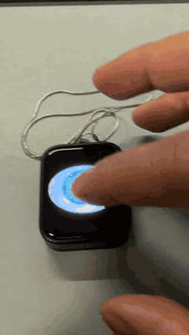
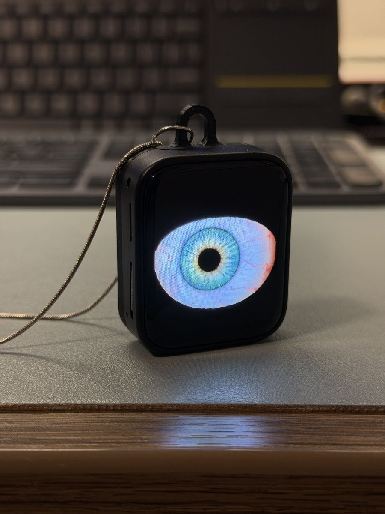
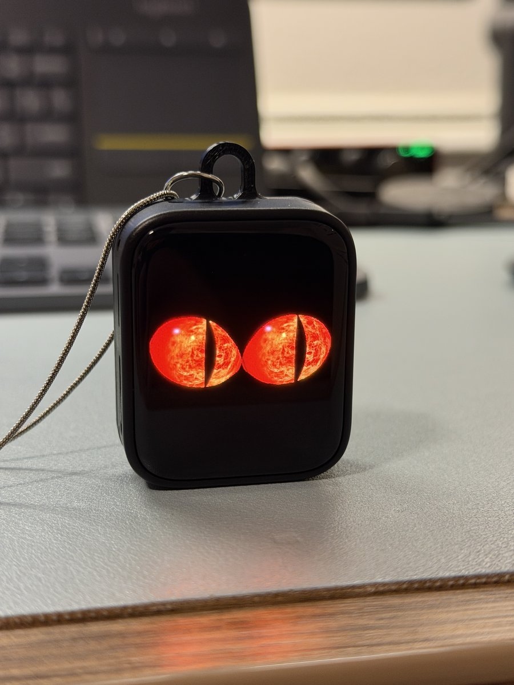
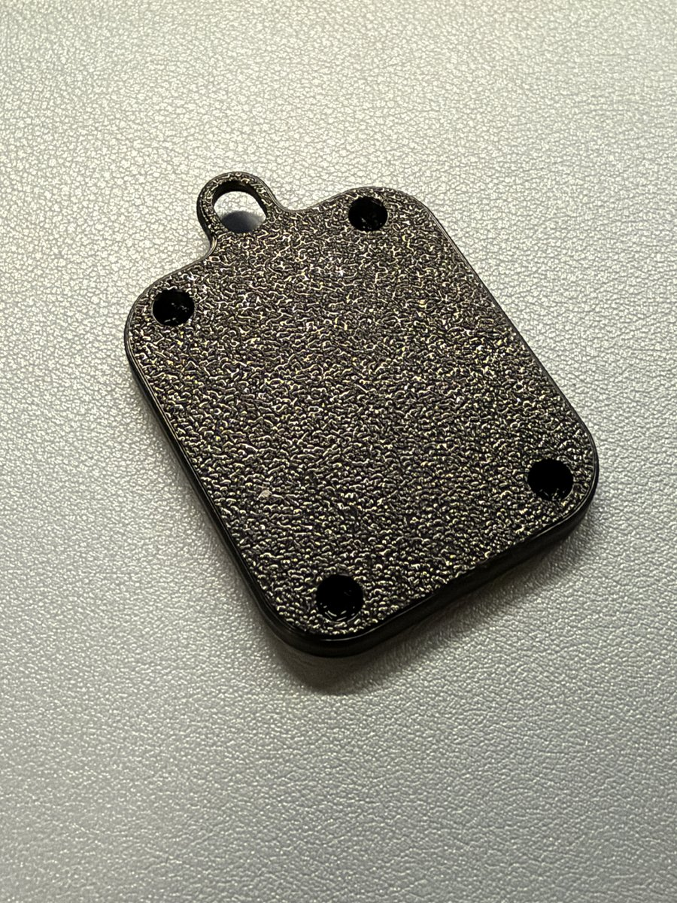
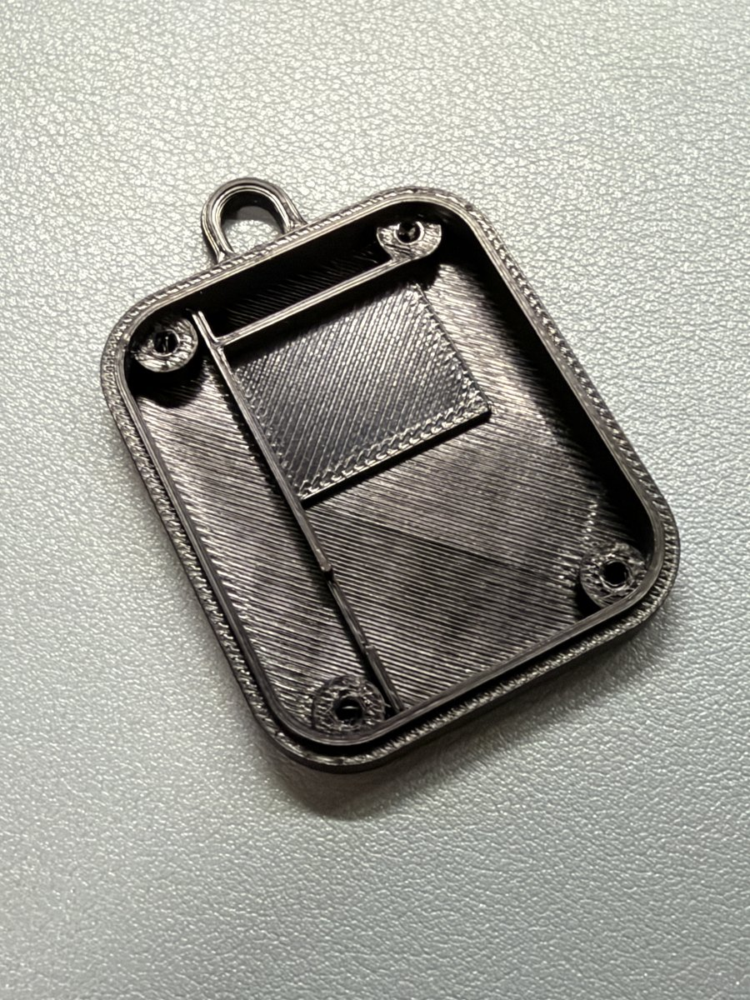

# RP2350 eyeballs

An animated eyeball pendant. A realistic (or cute, or evil) eye that looks around, blinks, follows gravity when you tilt it, gets dizzy when you shake it, and falls asleep when you leave it alone. It runs on a Waveshare dev board that costs under $30 with a 1.8-inch AMOLED screen, and a 3D-printed back turns it into a necklace.

<a href="docs/media/demo.mp4"></a>

▶️ [Watch the full demo video](docs/media/demo.mp4) (1 minute)

<p>
  
  
</p>

## What you need

| Part | Notes |
| --- | --- |
| [Waveshare RP2350-Touch-AMOLED-1.8](https://www.waveshare.com/rp2350-touch-amoled-1.8.htm) | Get the version **with the battery**; it comes with a case. Also sold by [The Pi Hut](https://thepihut.com/products/rp2350-1-8-amoled-touch-display-dev-board-368x448), [PiShop](https://www.pishop.us/product/rp2350-1-8inch-amoled-touch-display-development-board-368-448/) and others. Specs and demos: [Waveshare wiki](https://www.waveshare.com/wiki/RP2350-Touch-AMOLED-1.8) |
| USB-C cable | For flashing and charging |
| 3D printer (optional) | For the pendant back, below |
| Chain and a jump ring (optional) | Anything that fits through the bail |

The board has an RP2350 microcontroller, a 368×448 AMOLED touchscreen, a motion sensor, a real-time clock and battery charging built in, so there is no wiring or soldering.

## 1. Flash the firmware

You don't need to build anything to try it. Prebuilt firmware is in [`dist/`](dist/).

1. Hold the **BOOT** button on the board and plug it into your computer over USB-C. A drive named `RP2350` appears.
2. Drag [`dist/pendant.uf2`](dist/pendant.uf2) onto that drive. It's about 5MB, so the copy takes a few seconds.
3. The board reboots by itself and an eye opens.

## 2. Use it

### Touch

Touch is locked by default, so clothes and hugs don't change anything.

| Do this | Result |
| --- | --- |
| Press and hold for about a second | Unlock. `UNLOCKED` shows under the eye. Hold again to lock |
| Swipe left or right | Next or previous eye style; its name shows for a moment |
| Swipe up or down | Brighter or dimmer, in six steps |
| Tap | Switch between one big eye and a pair of eyes |
| Double tap | Show or hide a debug readout |
| Leave it alone for 10 seconds | Locks itself again |

The style, layout and brightness are remembered while the pendant is off. A red `LOW BATTERY` appears under the eye once a minute when the battery is at 10% or less.

### Motion

On its own, the eye glances around, blinks, and lets its pupil drift. It also reacts to deliberate movement, but ignores the bouncing and swinging of normal walking.

| Do this | The eye |
| --- | --- |
| Tilt it and hold | Looks toward the ground, then drifts back over about 10 seconds |
| Turn it quickly | Lags behind, then catches up |
| Shake it | Goes wide-eyed with a tiny pupil, then rolls dizzily for a couple of seconds |
| Leave it still for 40 seconds | Gets drowsy; at 60 seconds it closes and the pendant powers off |

On USB power the board can't turn itself off, so it goes dark instead and wakes when moved.

### Eye styles

There are 12 styles, in swipe order:

| Realistic | Cute | Evil | Odd |
| --- | --- | --- | --- |
| hazel, big_blue | anime, fizzgig | snake_green, demon, doom-red, skull | hypno_red, toonstripe, doom-spiral, spikes |

Every style also works as a pair. In pair mode the right eye's lids are mirrored, so the two read as a face.

## 3. Print the pendant back

[`hardware/rp2350-pendant-back-lid.stl`](hardware/rp2350-pendant-back-lid.stl) is a replacement back lid for Waveshare's case with a bail on top for a chain. It's about 38 × 54 × 6mm.

<p>
  
  
</p>


## 4. Build from source (optional)

You only need this to change the code or the eye styles. On a Mac:

```sh
brew install cmake ninja
brew install --cask gcc-arm-embedded
./build.sh
```

`build.sh` builds everything into `build/` and copies the `.uf2` files to `dist/`. The first run downloads the [Pico SDK](https://github.com/raspberrypi/pico-sdk) unless `PICO_SDK_PATH` is already set. On Linux or Windows, install CMake, Ninja and the Arm GNU toolchain however you usually would, then run the same script.

### Add or change eye styles

Each folder in [`art/`](art/) is one style in the [Adafruit Monster Eyes](https://learn.adafruit.com/adafruit-monster-eyes) format: a `config.eye` file plus bitmaps for the iris, sclera and eyelids.

```sh
pip3 install pillow numpy
tools/pack_all.sh
./build.sh
```

`tools/pack_all.sh` converts every folder into C data in `firmware/eye/styles/`. The `STYLES` line at its top chooses which styles are included and their swipe order. Adafruit's [CustomEyesation guide](https://learn.adafruit.com/customeyesation-diy-monster-m4sk-graphics) explains how to make your own texture maps.

Supported from `config.eye`: textures, plain colours, eye and iris size, pupil range, slit pupils, eyelid shapes (or none), and spin.

To check a style without flashing, `tools/sim/run.sh` renders the eye on your computer to image files. It can render test poses, frames of the idle behaviour, every style, or every style as a pair; see the comment at the top of [`tools/sim/sim.c`](tools/sim/sim.c).

### Tune the behaviour

Thresholds and timings are named constants at the top of [`firmware/eye/behave.c`](firmware/eye/behave.c) (glances, blinks, pupil) and [`firmware/eye/motion.c`](firmware/eye/motion.c) (tilt, turn, shake, sleep). [`tools/sim/motion_check.c`](tools/sim/motion_check.c) runs the motion detector against simulated walking, tilting, turning and shaking, so you can check a change before flashing.

The debug readout (double tap when unlocked) helps here. Its top line is the motion sensor's reading (x, y, z in g), a letter for the current reaction (`S` shaken, `Z` dizzy, `D` drowsy) and the battery percentage. The bottom line is the frame rate and `BUSY`, the milliseconds of each 33ms frame spent working.

## How it works

The eye is a sphere seen straight on. For each screen pixel, the renderer projects onto the sphere, rotates by the gaze, and looks up a colour in a flat iris texture or a sclera texture. Pupil size stretches the iris texture, eyelids are a top and bottom edge per column, and edge shading plus a soft highlight make it read as a wet ball.

The RP2350 has 520KB of RAM, too little for a full frame, so the eye is drawn in 16-row strips. Both processor cores draw alternate strips while the previous ones are sent to the screen by DMA. A full-size 368px eye draws at 35 to 42 frames per second, and the pendant holds it at a steady 30.

| Path | What it is |
| --- | --- |
| `firmware/pendant/` | The pendant firmware: touch, settings, battery, sleep |
| `firmware/eye/` | Renderer, behaviour, motion detection and eye styles. Portable C with no board code, so it also runs on a computer |
| `firmware/common/` | Draws one eye or a pair to the screen using both cores |
| `firmware/board/` | Board drivers: display, touch, motion sensor, power button, clock |
| `firmware/eyetest/`, `firmware/bringup/` | A render benchmark and a hardware test (see below) |
| `art/`, `tools/` | Source art, the converter, and the computer-side checks |
| `hardware/` | The pendant back lid |
| `dist/` | Prebuilt firmware |

## Troubleshooting

Two extra firmwares in `dist/` help if something isn't working.

**`bringup.uf2`** tests the hardware. It fills the screen red, green, blue and white, measures the display speed, then shows live readings:

| Line | Expected |
| --- | --- |
| `FULL`, `EYE368` | About 113 and 138 frames per second |
| `IMU` / `TOUCH ID` | `IMU OK` and a non-zero ID |
| `ACC` | Three numbers that change as you tilt the board |
| `TOUCH` | Coordinates under your finger |
| `PWR BTN` | Counts that go up on short and long presses |
| `BATTERY` | A percentage, with the battery attached |

Holding a finger on the screen for 3 seconds tests the software power-off (on battery only).

**`eyetest.uf2`** runs the eye as fast as it can and shows the frame rate. Tap to switch between `FULL` (shading and highlight) and `PLAIN`. Expect about 35 to 42 fps in `FULL` and 44 to 54 in `PLAIN`.

## Sources and credits

### Photos, video and pendant back

The photos in `docs/images/`, the video in `docs/media/` and the back lid in `hardware/` are by the author of this repo.

### Eye art

Every style in [`art/`](art/) comes unchanged from Adafruit's [M4_Eyes](https://github.com/adafruit/Adafruit_Learning_System_Guides/tree/main/M4_Eyes) project by Phil Burgess, part of the [Adafruit Learning System Guides](https://github.com/adafruit/Adafruit_Learning_System_Guides) repository, which is [MIT licensed](https://github.com/adafruit/Adafruit_Learning_System_Guides/blob/main/LICENSE). The files in `firmware/eye/styles/` are generated from that art by `tools/eyepack.py`.

| Style | Source folder |
| --- | --- |
| hazel | [`M4_Eyes/eyes/hazel`](https://github.com/adafruit/Adafruit_Learning_System_Guides/tree/main/M4_Eyes/eyes/hazel) |
| big_blue | [`M4_Eyes/eyes/big_blue`](https://github.com/adafruit/Adafruit_Learning_System_Guides/tree/main/M4_Eyes/eyes/big_blue) |
| anime | [`M4_Eyes/eyes/anime`](https://github.com/adafruit/Adafruit_Learning_System_Guides/tree/main/M4_Eyes/eyes/anime) |
| fizzgig | [`M4_Eyes/eyes/fizzgig`](https://github.com/adafruit/Adafruit_Learning_System_Guides/tree/main/M4_Eyes/eyes/fizzgig) (includes sound files the pendant doesn't use) |
| snake_green | [`M4_Eyes/eyes/snake_green`](https://github.com/adafruit/Adafruit_Learning_System_Guides/tree/main/M4_Eyes/eyes/snake_green) |
| demon | [`M4_Eyes/eyes/demon`](https://github.com/adafruit/Adafruit_Learning_System_Guides/tree/main/M4_Eyes/eyes/demon) |
| doom-red | [`M4_Eyes/eyes/doom-red`](https://github.com/adafruit/Adafruit_Learning_System_Guides/tree/main/M4_Eyes/eyes/doom-red) |
| skull | [`M4_Eyes/eyes/skull`](https://github.com/adafruit/Adafruit_Learning_System_Guides/tree/main/M4_Eyes/eyes/skull) |
| hypno_red | [`M4_Eyes/eyes/hypno_red`](https://github.com/adafruit/Adafruit_Learning_System_Guides/tree/main/M4_Eyes/eyes/hypno_red) |
| toonstripe | [`M4_Eyes/eyes/toonstripe`](https://github.com/adafruit/Adafruit_Learning_System_Guides/tree/main/M4_Eyes/eyes/toonstripe) |
| doom-spiral | [`M4_Eyes/eyes/doom-spiral`](https://github.com/adafruit/Adafruit_Learning_System_Guides/tree/main/M4_Eyes/eyes/doom-spiral) |
| spikes | [`M4_Eyes/eyes/spikes`](https://github.com/adafruit/Adafruit_Learning_System_Guides/tree/main/M4_Eyes/eyes/spikes) |
| fish_eyes, reflection | [`M4_Eyes/eyes`](https://github.com/adafruit/Adafruit_Learning_System_Guides/tree/main/M4_Eyes/eyes) (in `art/` but not built into the firmware) |

Adafruit's guides describe the styles and the art format: [Monster Eyes: ready-made graphics](https://learn.adafruit.com/adafruit-monster-eyes/graphics) and [CustomEyesation: DIY Monster M4SK Graphics](https://learn.adafruit.com/customeyesation-diy-monster-m4sk-graphics).

### Code

| Code | Source | License |
| --- | --- | --- |
| `firmware/eye/`, `firmware/common/`, `firmware/pendant/`, `tools/` | Written for this project. The rendering approach (texture-mapped sphere, eyelids as per-column edges) follows Adafruit's [M4_Eyes](https://github.com/adafruit/Adafruit_Learning_System_Guides/tree/main/M4_Eyes) and [Adafruit_Monster_Eyes](https://github.com/adafruit/Adafruit_Monster_Eyes), but no code was copied from them | — |
| `firmware/board/` display, QSPI, touch, motion sensor, power button and GUI drivers | Waveshare's [demo code for this board](https://www.waveshare.com/wiki/RP2350-Touch-AMOLED-1.8), by way of [artsvuni/rp2350-doom](https://github.com/artsvuni/rp2350-doom), which fixed several reliability problems in them | Waveshare's permissive header in each file. rp2350-doom has no license file for its own changes |
| `firmware/board/fonts/` | Bitmap fonts shipped in Waveshare's demos, originally from STMicroelectronics | BSD-style; notice in each file |
| `firmware/board/pcf85063/` | Written for this project from the PCF85063 register map | — |
| `pico_sdk_import.cmake` and the build system | [Raspberry Pi Pico SDK](https://github.com/raspberrypi/pico-sdk) | [BSD-3-Clause](https://github.com/raspberrypi/pico-sdk/blob/master/LICENSE.TXT) |

Local changes to the Waveshare drivers: the speaker amplifier is always held off, a buffer overrun in `Paint_Clear` is fixed, the display driver gained a non-blocking write, the motion-sensor driver gained gyroscope support, and include paths were adjusted.

### Inspiration

- [Adafruit Monster Eyes](https://learn.adafruit.com/adafruit-monster-eyes), the latest version of Adafruit's animated eyes
- [Eye Pendant V2](https://community.element14.com/challenges-projects/halloween/a/projects/PR188/eye-pendant-v2) on element14, an eye pendant on a Waveshare ESP32-S3 board
